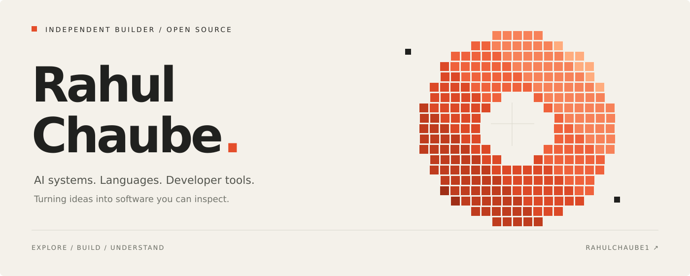

  

  <strong>Rahul Chaube</strong> 
  AI · Machine Learning · Language Models · Open-Source Systems

  Building AI systems. Exploring how machines learn, reason, and act.

  <a href="https://github.com/Rahulchaube1/blyxxxx">Blyx</a> &nbsp; / &nbsp;
  <a href="https://github.com/Rahulchaube1?tab=repositories">Projects</a> &nbsp; / &nbsp;
  <a href="https://www.linkedin.com/in/rahul-chaube-2520b21b7/">LinkedIn</a>

  
Contribution drive — show / hide animation

   
  

    
  

