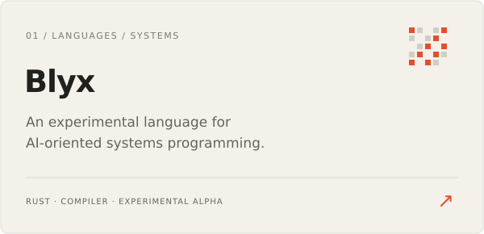
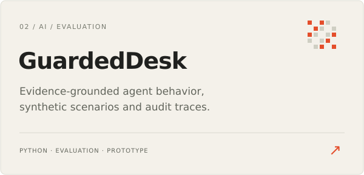
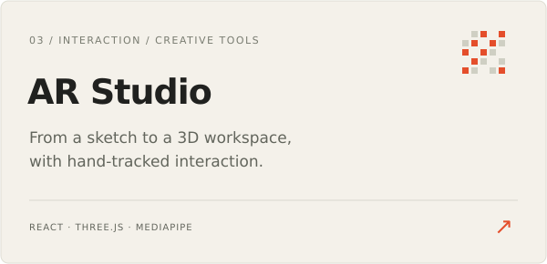
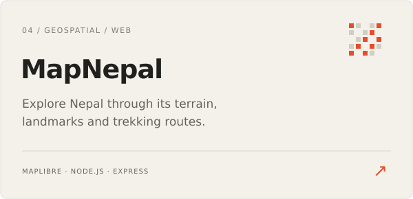

  <a href="#selected-work">Selected work</a> &nbsp; / &nbsp;
  <a href="https://github.com/Rahulchaube1?tab=repositories">All repositories</a> &nbsp; / &nbsp;
  <a href="https://www.linkedin.com/in/rahul-chaube-2520b21b7/">LinkedIn ↗</a>

 

I build open-source software at the intersection of **AI, systems programming, and interactive tools**. My interests range from language compilers to agent evaluation and spatial interfaces.

I care about what the code actually does: clear behavior, reproducible experiments, and honest documentation of what is still in progress.

 

## Selected work

Blyx is experimental alpha software; native code generation is still in development. GuardedDesk is an evaluation prototype, not a production refund system.

  

## What draws me in

**AI that can be inspected.** Evidence-grounded agents, evaluation tools, and traces that make behavior easier to understand.

**Systems that explain themselves.** Language design, compiler internals, and developer tools with clear boundaries.

**Interfaces worth using.** Interactive graphics, spatial workflows, and applications that make complex ideas tangible.

 

---

Open to technical conversations and focused open-source collaboration. Start with an issue in a project above, or [connect on LinkedIn](https://www.linkedin.com/in/rahul-chaube-2520b21b7/).
