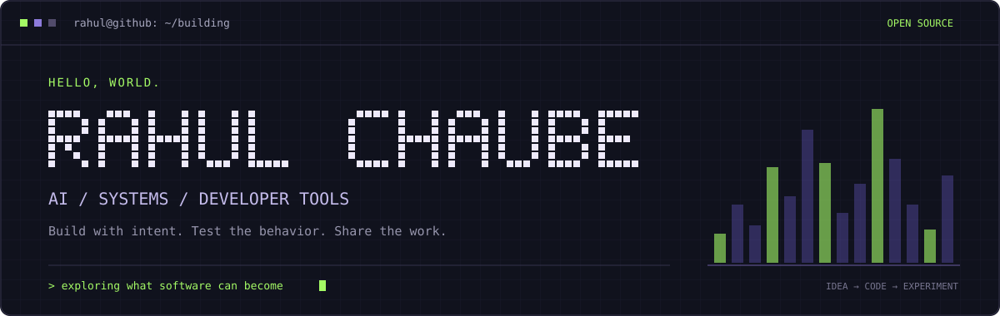

<p align="center">
  
</p>

<p align="center">
  <a href="#selected-work">Selected work</a> ·
  <a href="#engineering-focus">Engineering focus</a> ·
  <a href="https://github.com/Rahulchaube1?tab=repositories">Repositories</a> ·
  <a href="https://www.linkedin.com/in/rahul-chaube-2520b21b7/">LinkedIn</a>
</p>

## About

I'm Rahul. I build open-source software across **AI, systems programming, and developer tools**.

My work ranges from an experimental language compiler to evidence-grounded agent prototypes and interactive 3D applications. I'm interested in the details that make an idea worth using: clear behavior, useful interfaces, and reproducible experiments.

## Selected work

<table>
<tr>
<td width="50%" valign="top">

### ▸ Blyx
**LANGUAGES / SYSTEMS**

An experimental systems programming language exploring AI-oriented computation.

Rust compiler · Language design · BIR/SSA

**Status:** Experimental alpha. Native code generation is still in development.

[Explore the repository →](https://github.com/Rahulchaube1/blyxxxx)

</td>
<td width="50%" valign="top">

### ▸ GuardedDesk
**AI / AGENT EVALUATION**

An evidence-grounded return eligibility agent prototype with synthetic scenarios, strict trajectory scoring, and audit traces.

Python · Evaluation harness · Agent traces

**Status:** Prototype. A testbed for inspecting agent behavior, not a production refund system.

[Explore the repository →](https://github.com/Rahulchaube1/GuardedDesk)

</td>
</tr>
<tr>
<td width="50%" valign="top">

### ▸ AR Studio
**INTERACTION / CREATIVE TOOLS**

A browser-based drawing and 3D creation workspace with hand-tracked interaction.

React · Three.js · MediaPipe

[Explore the repository →](https://github.com/Rahulchaube1/AR)

</td>
<td width="50%" valign="top">

### ▸ MapNepal
**MAPS / WEB APPLICATIONS**

A mapping application for exploring Nepal through terrain, landmarks, and trekking routes.

MapLibre · Node.js · Express

[Explore the repository →](https://github.com/Rahulchaube1/mapnepal)

</td>
</tr>
</table>

## Engineering focus

```text
01  AI & agents       Evidence, evaluation, inspectable behavior
02  Languages         Compilers, intermediate representations, tooling
03  Interfaces        Interactive graphics, spatial tools, useful workflows
04  Open source       Clear documentation, focused changes, reproducible work
```

## How I build

**Start with a useful problem. Make the behavior testable. Document the limits.**

I prefer showing the implementation to making big claims. Technical feedback, bug reports, and focused contributions are welcome in the repositories above.

---

<p align="center">
  <code>IDEA → CODE → EXPERIMENT → IMPROVE</code><br /><br />
  <a href="https://www.linkedin.com/in/rahul-chaube-2520b21b7/">Connect on LinkedIn</a> ·
  <a href="https://github.com/Rahulchaube1?tab=repositories">Explore my work</a>
</p>
